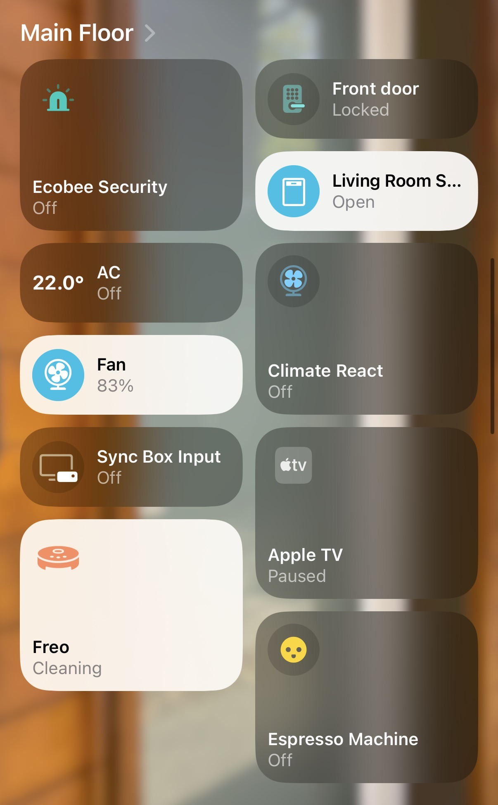
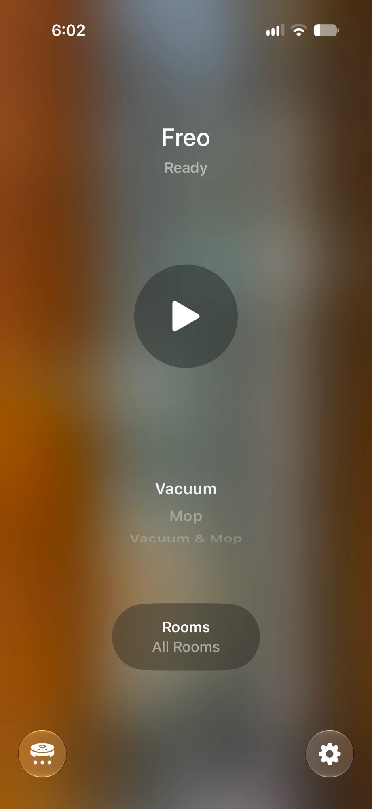
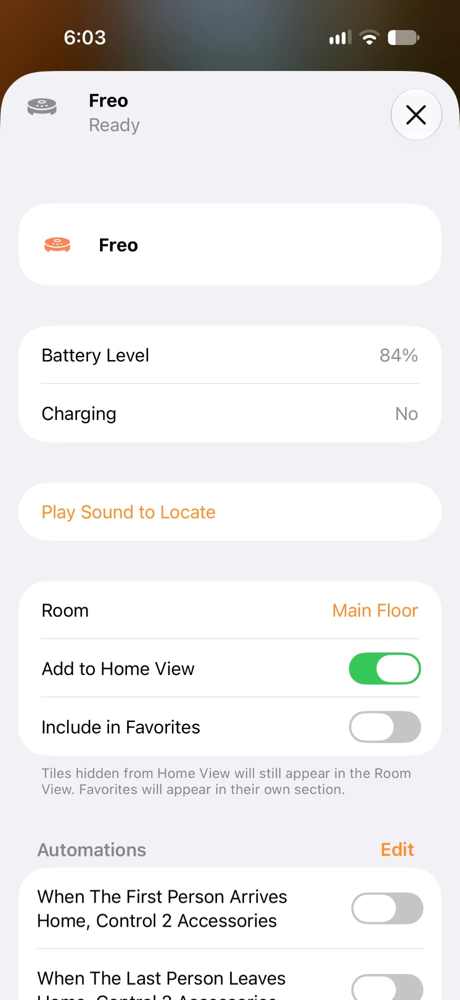
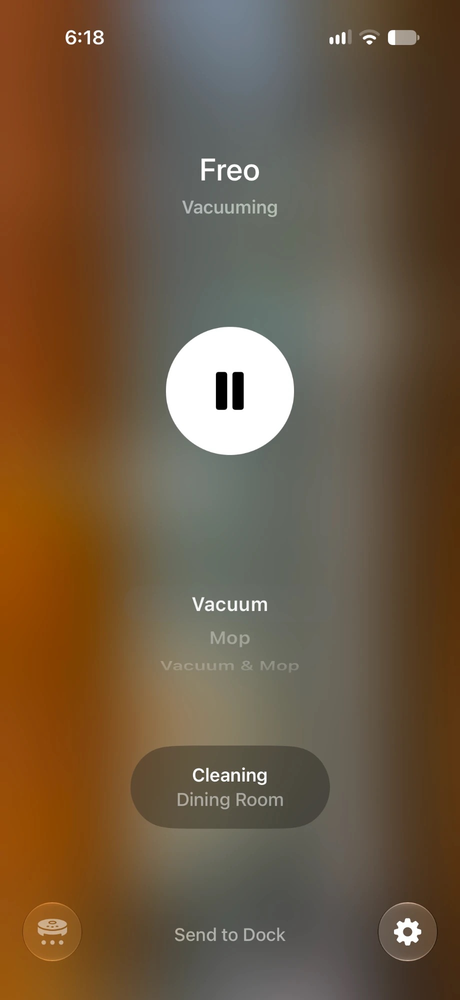
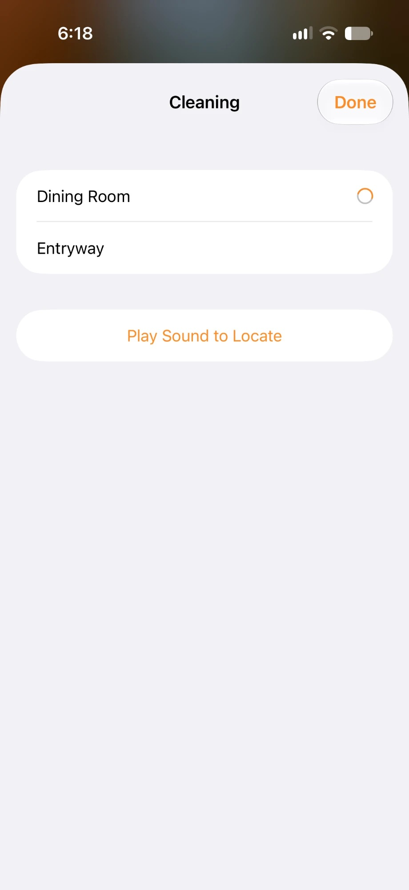
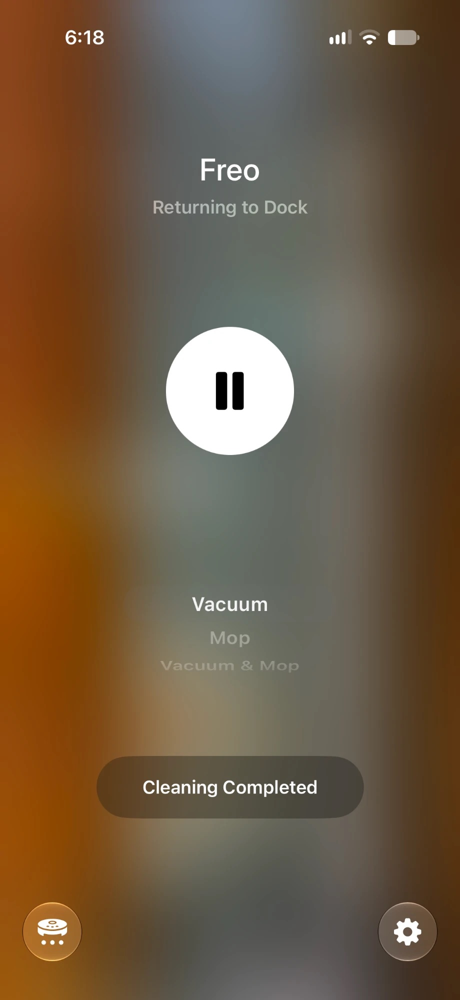
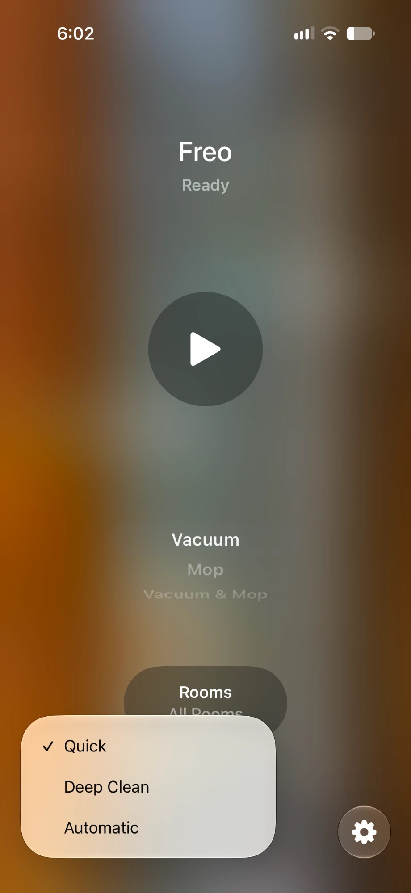
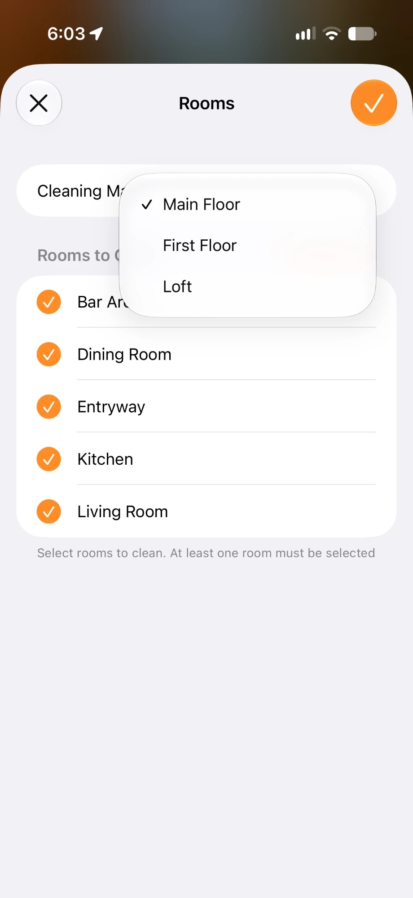
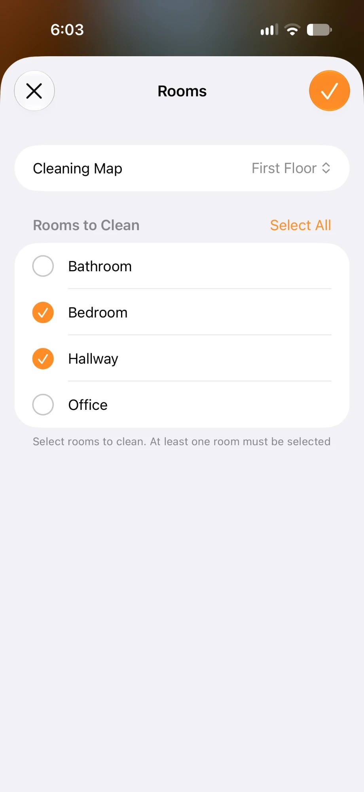
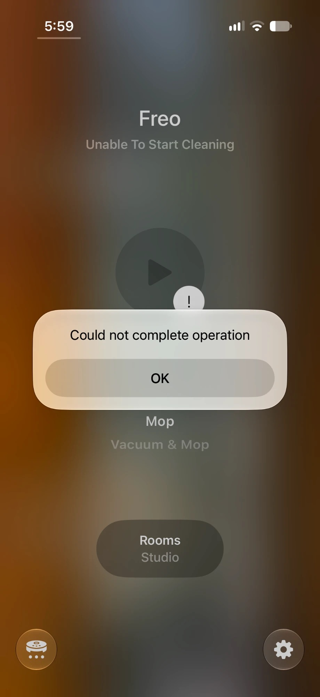

<p align="center"></p>

# homebridge-narwal-freo

<p align="center">
  <a href="https://github.com/homebridge/homebridge/wiki/Verified-Plugins"></a>
  <a href="https://www.npmjs.com/package/homebridge-narwal-freo"></a>
  <a href="https://www.npmjs.com/package/homebridge-narwal-freo"></a>
  <a href="LICENSE"></a>
</p>

This plugin adds the original **Narwal Freo** to Apple Home as a robot vacuum. In the Home app you can:

- start, pause, resume and send the robot back to its base
- choose rooms and a clean mode
- see the battery level and whether the robot is charging
- clean rooms on the other floors of your home, if the robot has a map for them

Optional extras add a sensor for automations, the remaining life of brushes and filters, a vacation mode and a link to your security system.

<p align="center"></p>

**Only the original Freo (model YJCC012) is supported.** Newer Narwal robots, such as the Freo X and Freo Z, don't work with this plugin.

This plugin is not made by Narwal. It controls the robot through Narwal's cloud, as the Narwal app does.

## Contents

- [Before you start](#before-you-start)
- [Set up](#set-up)
- [Use the robot in the Home app](#use-the-robot-in-the-home-app)
  - [Start and stop a clean](#start-and-stop-a-clean)
  - [Follow a clean](#follow-a-clean)
  - [Choose a clean mode](#choose-a-clean-mode)
  - [Change what each clean mode does](#change-what-each-clean-mode-does)
  - [Name your rooms](#name-your-rooms)
- [Clean another floor](#clean-another-floor)
  - [Clean the rooms on a secondary map](#clean-the-rooms-on-a-secondary-map)
  - [Set stair detection](#set-stair-detection)
- [Known limitations](#known-limitations)
- [If something goes wrong](#if-something-goes-wrong)
  - [A clean doesn't start](#a-clean-doesnt-start)
  - [The Home app shows an error](#the-home-app-shows-an-error)
- [Optional extras](#optional-extras)
  - [Cleaning sensor](#cleaning-sensor)
  - [Consumables](#consumables)
  - [Vacation mode](#vacation-mode)
  - [Security hold](#security-hold)
- [Settings in config.json](#settings-in-configjson)
- [How the plugin works](#how-the-plugin-works)
- [Credits](#credits)

## Before you start

You need:

- Homebridge 2.4 or newer, with Node.js 22 or newer
- an Apple Home hub: a HomePod or an Apple TV
- the email address and password you use in the Narwal app

## Set up

1. In the Homebridge UI, install **homebridge-narwal-freo** from the **Plugins** page.
2. Open the plugin's settings and sign in with your Narwal email address and password. If your Narwal account isn't in the US region, choose your region too. The settings page lists the robots on your account.
3. The robot is added to the Home app with Matter, so the plugin's child bridge needs Matter turned on. In the Homebridge UI, open **JSON Config** and add this `matter` block to the plugin's `_bridge` section:

   ```json
   "matter": { "enabled": false, "externalsOnly": true, "disableIpv4": true }
   ```

   Then restart the plugin's child bridge.
4. In the Homebridge log, find the line **Commissioning codes for** followed by your robot's name. The log shows a QR code and a setup code under it.
5. In the Home app, tap **+**, then **Add Accessory**, and scan the QR code or enter the setup code.

The robot appears in the Home app as a robot vacuum. If the log says **Matter is not enabled for this bridge**, check the `matter` block from step 3.

If you have more than one Freo, each one gets its own setup code. Add each one in the Home app.

## Use the robot in the Home app

### Start and stop a clean

Open the robot in the Home app:

<p align="center"><a href="images/home-tile-cleaning.jpg"></a>&nbsp;&nbsp;<a href="images/home-controls.jpg"></a></p>

- To start, tap the play button. To pause or resume, tap it again.
- To choose rooms, tap **Rooms**. If the robot has more than one map, choose the map first under **Cleaning Map**.
- To send the robot back to its base, tap **Send to Dock**.
- To find the robot, tap the settings button in the bottom-right corner, then **Play Sound to Locate**. The robot plays its locate sound. The same screen shows the battery level and whether the robot is charging.

<p align="center"><a href="images/home-settings.jpg"></a></p>

You can also ask Siri, for example "vacuum the kitchen".

A start that doesn't choose rooms, such as from Siri or an automation, cleans every room on the main map. After every clean, the Home app shows the main map with every room selected again.

### Follow a clean

While the robot cleans, the Home app shows what it's doing, such as **Traveling to Room**, **Vacuuming** or **Returning to Dock**. The button below the clean modes shows the room being cleaned. Tap it to see the rooms in this clean. The room in progress is marked.

When the clean is over, the button shows **Cleaning Completed**.

<p align="center"><a href="images/home-traveling.jpg"></a>&nbsp;<a href="images/home-vacuuming.jpg"></a>&nbsp;<a href="images/home-cleaning-rooms.jpg"></a>&nbsp;<a href="images/home-returning.jpg"></a></p>

### Choose a clean mode

Below the play button, choose **Vacuum**, **Mop** or **Vacuum & Mop**.

Each of these three modes has three settings: **Automatic**, **Quick** and **Deep Clean**. To choose one, tap the **⋯** button in the bottom-left corner. The menu applies to the mode you chose.

<p align="center"><a href="images/home-mode-menu.jpg"></a></p>

Unless you change them, the nine settings do this:

| Mode | Automatic | Quick | Deep Clean |
|---|---|---|---|
| Vacuum | Narwal app settings | 1 pass | 2 passes |
| Mop | Narwal app settings | 1 pass | 2 passes |
| Vacuum & Mop | Vacuum and mop together, Narwal app settings | Vacuum and mop together, 1 pass | Vacuum first, then mop, 2 passes each |

"Narwal app settings" are the suction, water and passes you have set for each mode in the Narwal app. They apply to every room.

### Change what each clean mode does

In the plugin's settings, under **Clean modes**, you can set each of the nine settings:

- **Passes:** 1, 2 or 3
- **Suction:** Quiet, Standard, Strong or Max
- **Water:** Slightly dry, Standard or Slightly wet
- **Task** (Vacuum & Mop only): Vacuum and Mop, Vacuum then Mop, or Freo Mind. With Freo Mind, the robot chooses passes, suction and water itself.

**Default** uses the Narwal app settings. The floor type you set for each room in the Narwal app, such as wood or tile, still applies. The robot uses it to adjust mopping.

### Name your rooms

The Home app shows the room names from the Narwal app. Name your rooms there first:

1. In the Narwal app, give each room a name or type, such as Kitchen or Bedroom.
2. In the Homebridge UI, restart the plugin's child bridge.

The new names appear in the Home app. A room without a name shows as "Room", "Room 2" and so on. Without a restart, the plugin picks up new names within a few hours.

To use a different name in the Home app only, enter it in the **Home app** column of the room list in the plugin's settings. Scenes and automations keep working after you rename a room.

<a name="multiple-floors-in-development"></a>

## Clean another floor

The Freo can keep a separate map for each floor of your home. Multi-map support in this plugin is new. Read [Known limitations](#known-limitations) before you use it.

- The **main map** is the map with the robot's base.
- A **secondary map** is a map without a base, such as an upstairs floor.
- The **starting point** is the spot marked **P** on a secondary map in the Narwal app.

The Home app lists every map under **Cleaning Map** when you choose rooms. Cleaning rooms on the main map works as described above.

### Clean the rooms on a secondary map

<p align="center"><a href="images/home-cleaning-map.jpg"></a>&nbsp;&nbsp;<a href="images/home-secondary-rooms.jpg"></a></p>

1. Carry the robot to the starting point of the map.
2. In the Home app, open the robot and tap **Rooms**.
3. Under **Cleaning Map**, choose the map, then choose the rooms.
4. Choose **Vacuum**, then tap the play button.

The robot cleans the rooms one at a time. It starts with the room that holds the starting point, then moves to the nearest room left. When it has cleaned the last room, it drives back to the starting point and stops there. The Home app shows **Returning to Dock** while the robot drives to the starting point.

When it's done:

- To finish, carry the robot back onto its base.
- To clean another secondary map, carry the robot to that map's starting point and repeat steps 2 to 4. Start from the Home app, not from Siri or an automation.

If you tap **Send to Dock** during a clean on a secondary map, the robot stops cleaning and drives back to the starting point.

If the battery drops to 10% during a clean on a secondary map, the robot stops cleaning and drives back to the starting point. The Home app shows a low battery error until you put the robot back on its base or start a new clean.

### Set stair detection

Stair detection keeps the robot from driving down stairs. On some dark floors, it can also stop the robot with a false "stuck" error.

In the plugin's settings, each map and each room has a **Detect stairs** switch. It's on for every map unless you turn it off. Turn it off only for a map or room with no stairs going down.

On a secondary map, the robot keeps stair detection on while it drives to a room. It only turns stair detection off once it's inside a room you turned it off for. After every clean, the plugin turns stair detection back on.

If the robot has only one map, the plugin doesn't change stair detection unless you set it.

## Known limitations

- **Multi-map support is new.** It has been tested on one home with three maps.
- **Secondary maps are vacuum only.** Narwal only allows zone cleaning on a map without a base, and there is no base to wash the mops. A Mop or combined start on a secondary map doesn't start.
- **The plugin can't tell when you carry the robot.** It assumes the robot is still on the map it last cleaned, until you put it back on its base. Choosing rooms in the Home app tells the plugin you have moved the robot to that map.
- **On a secondary map, Send to Dock only works during a clean.** When the robot is idle there, the plugin can't tell whether it's still at the starting point or you have carried it away. Put it back on its base yourself.
- **The plugin turns off one Narwal app setting.** On a robot with more than one map, the plugin turns off **Automatically switch to the main map after cleaning** in the Narwal app. Instead, the plugin switches the robot to the main map whenever the robot is on its base.
- **Don't tap "End Mop Wash & Dry" in the Narwal app while the robot is off its base.** The robot then drives off to find its base by itself.
- **Schedules set in the Narwal app can't be controlled by the plugin.** For vacation mode to work, schedule cleans with Home app automations.

## If something goes wrong

### A clean doesn't start

When the plugin doesn't start a clean, the Home app shows **Unable To Start Cleaning** and the message **Could not complete operation**. The Homebridge log has a line starting with **Not cleaning:** that gives the reason.

<p align="center"><a href="images/home-unable-to-start.jpg"></a></p>

| Reason in the log | What to do |
|---|---|
| The Freo is on its base, not at the starting point of *map* | Carry the robot to the map's starting point, then start again. |
| The Freo is on *map* (a secondary map) and was asked to clean *other map* | Choose the rooms again in the Home app and start from there. Or put the robot back on its base first. |
| *map* is a secondary map, which is vacuum only | Choose **Vacuum** and start again. |
| Some of the selected rooms no longer exist | Choose the rooms again. A room was removed or changed in the Narwal app. |
| Can't change to *map* while the robot is cleaning | Wait until the current clean ends. |
| … *map* needs stair detection on | Try again. The robot didn't accept the stair detection setting. |
| Could not change to *map* | Try again. The robot didn't switch maps. |
| Could not read the map of *map* to shape the zones | Try again in a minute. |
| None of the selected rooms has floor space on the map of *map* | Choose other rooms. Check the map in the Narwal app. |
| The security system said no, or could not check the security system | Check your security system. With **Hold security while cleaning** on, the robot only starts when the security system allows it. |

For **Send to Dock** on a secondary map while the robot is idle, the log says **Not returning:**. Put the robot back on its base yourself.

### The Home app shows an error

The Home app shows the robot's own errors, such as a full dust bin or a stuck brush, with Narwal's description. These clear when you fix the problem.

The plugin also shows these errors:

| Situation | Cause | What to do |
|---|---|---|
| The robot doesn't get back to its base | The base is unplugged or the way is blocked. The plugin expects the robot within about three times its usual return time. | Check the base and the path to it. |
| Low battery while away from the base | The robot stopped responding away from its base, so its battery is probably flat. | Put the robot back on its base. |
| Low battery on a secondary map | The battery dropped to 10% and the robot went back to the starting point. | Put the robot back on its base. |
| The robot doesn't respond after Homebridge starts | The robot is off or offline. | Check that the robot is on and connected to Wi-Fi. |
| The clean stops right after it starts on a secondary map | The robot placed itself on a different map. | Carry the robot to the starting point and start again. |

## Optional extras

For the cleaning sensor, consumables and the plugin's own vacation switch, add the plugin's child bridge to the Home app as well. You find its setup code in the Homebridge UI under **Bridges**. The robot itself keeps its own Matter pairing.

### Cleaning sensor

The Home app can't start an automation when the robot starts or stops cleaning. Turn on **Show a cleaning sensor** to add an occupancy sensor called **Freo Cleaning**. It shows occupancy detected from the start to the end of a clean, including the robot's trips to the base to wash the mops. On a secondary map, it stays on until the robot is back at the starting point.

Use it in automations, for example "When Freo Cleaning detects occupancy".

### Consumables

Turn on **Show consumables** to see how much life is left on the filter, side brush, rolling brushes, mop and filter sponge.

Apple's Home app doesn't show these. Use another HomeKit app, such as Eve, Controller for HomeKit or Home+. Each part shows a warning when its life drops to the value under **Warn to replace at (% left)**, 10% unless you change it.

After you replace a part, reset its counter in that app or in the Narwal app.

### Vacation mode

Vacation mode reduces cleaning while you're away.

1. In the plugin's settings, turn on **Cut back cleaning on vacation**.
2. Under **Cleans allowed after it's turned on**, choose how many cleans run as usual. The default is 1.
3. Under **After that**, choose what happens to later cleans: skip them, or run them as vacuum-only cleans.

Turn on the **Vacation Mode** switch in the Home app when you leave, and turn it off when you're back. Resuming a paused clean always works.

The plugin uses a switch called "Vacation Mode" if you already have one on this Homebridge, for example from [homebridge-ecobee-security](https://github.com/seanfletchr/homebridge-ecobee-security) or [homebridge-dummy](https://github.com/mpatfield/homebridge-dummy). To find it, Homebridge's insecure mode must be on (it's on by default). If you don't have one, the plugin adds its own switch. The plugin keeps using the first switch it finds or adds. To change it, turn vacation mode off and on again in the plugin's settings.

Vacation mode can only skip cleans started from the Home app, including Home app automations. Cleans started in the Narwal app still run, and they count toward the cleans allowed.

### Security hold

Motion sensors can mistake a robot vacuum for an intruder. With **Hold security while cleaning** on, the plugin asks your security system to switch from Away to Home before the robot starts. Doors and windows stay armed. When the clean is over, the system switches back to Away.

If the security system doesn't allow the switch, the robot doesn't start. If Away is armed while the robot is cleaning, the robot heads back to its base, or pauses if it can't get there in time. A clean started outside the Home app, for example in the Narwal app, is paused as the robot leaves its base until the security system allows it.

This needs a security system plugin that supports it, such as [homebridge-ecobee-security](https://github.com/seanfletchr/homebridge-ecobee-security). For details, see [docs/security-hold.md](docs/security-hold.md).

## Settings in config.json

The settings page writes these settings for you. An example:

```json
{
  "platform": "NarwalPlatform",
  "name": "Narwal Freo",
  "email": "you@example.com",
  "password": "…",
  "robots": [
    { "serialNumber": "YA3…", "name": "Downstairs", "cleaningSensor": true, "consumables": true,
      "cleanModes": { "vacuumDeep": { "passes": "2", "suction": "strong" } },
      "maps": [
        { "id": 1, "stairDetection": false },
        { "id": 2, "name": "Upstairs", "rooms": [{ "id": 4, "name": "Hallway" }] }
      ] }
  ],
  "securityHold": true,
  "securityPlugin": "homebridge-example-security",
  "vacationMode": true,
  "vacationCleans": 1,
  "vacationAfter": "vacuum",
  "_bridge": {
    "username": "…",
    "port": 51916,
    "name": "Narwal Bridge",
    "matter": { "enabled": false, "externalsOnly": true, "disableIpv4": true }
  }
}
```

## How the plugin works

- The Freo has no local connection. The plugin signs in to Narwal's cloud and sends commands the way the Narwal app does. The Narwal app doesn't need to be open.
- The plugin reads the robot's maps, rooms and Narwal app settings from the robot, and checks for changes every 6 hours and whenever the robot's map changes.
- It stores the session and the maps in `narwal/state.json` in the Homebridge storage folder.
- On a secondary map, the robot can only clean zones. The plugin cleans each room as a zone shaped like the room, one room at a time. To bring the robot back to the starting point, the plugin starts a small zone clean there and stops the robot when it arrives.

For contributors: Matter keeps each vacuum's current clean mode. If that mode's number disappears from `lib/vacuum.js`, the vacuum can't be published. Reuse clean mode numbers; never remove one.

## Credits

The message formats come from three MIT-licensed Home Assistant integrations, checked against a real robot:
[mk0000001/ha-narwal-cloud](https://github.com/mk0000001/ha-narwal-cloud),
[madsah211/ha-narwal-cloud-eu](https://github.com/madsah211/ha-narwal-cloud-eu) and
[archieprichard/narwhal-cloud](https://github.com/archieprichard/narwhal-cloud).

Found a problem? See the [open issues](https://github.com/seanfletchr/homebridge-narwal-freo/issues).
